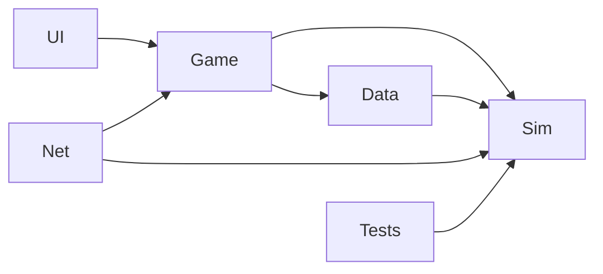

# 03. Архитектура

> **Кратко.** Делим код на сборки: чистая симуляция (без Unity) → данные → игра → UI → сеть. Целевая архитектура полной игры — команды, детерминированный стратегический тик и сервисы вместо статик; в текущем демо M2 сеть живёт в `EuropeanWar.Game` (`Assets/Scripts/Net`), стратегическая карта остаётся офлайн у хоста, а тактический бой синхронизируется через FishNet 4.7.4 (D-026…D-032). Миграция M1 (8 шагов) завершена 08.11.2026.

## 1. Текущее состояние и целевые границы

См. [00_Audit.md](00_Audit.md) (исходное состояние до M1). В результате M1 и шагов 1–6 M2 разделены:
- **Текущий код (M1 + M2 шаги 1–6):** сборки `EuropeanWar.Sim`, `EuropeanWar.Game` (включая сеть), `EuropeanWar.UI`, `EuropeanWar.Editor`, `EuropeanWar.AgentBridge`, `EuropeanWar.Tests.EditMode` (287 тестов; исторические рубежи D-031 — 236, D-030 — 205). В редакторе есть ссылка на `GameKit.Dependencies` для стабильных хешей префабов FishNet. Страны — `CountryId`, звания — `RankId` (None/Private/Sergeant), сохранение v3 мигрирует v1/v2. Карта передаёт в бой неизменяемый `BattleRequest`, получает `BattleResult`. Движение игроков клиентское; ИИ, здоровье, приказ отделению и исход решает хост. Клиент видит приказ/численность через `NetAvatar`, но не командует. Поза передаётся до 10 Гц, дружественный урон запрещён `DamageRules`, попаданиям клиента в дружеском коопе доверяем. Общей стратегической карты по сети нет.
- **Что относится к целевой архитектуре будущих этапов (M4/M5):** выделенные сборки `EuropeanWar.Data` и `EuropeanWar.Net`, объектные команды стратегии (`MoveArmy`, `StartFocus`, `SetProduction`, `AcceptEvent`) с передачей по сети и детерминированным тиком, полная лестница званий, отдельные отделения на каждого игрока с клиентским RPC приказов, шина событий Sim и серверная валидация/предсказание для PvP.

## 2. Целевые слои (план полной архитектуры)

| Сборка (asmdef) | Содержимое | Зависит от |
|---|---|---|
| `EuropeanWar.Sim` | мир, время, страны, точки, армии, снабжение, автобой, команды. Чистый C#, **без UnityEngine** | — |
| `EuropeanWar.Data` | определения: страны, оружие, юниты, фокусы, события (ScriptableObject/JSON) | Sim |
| `EuropeanWar.Game` | MonoBehaviour: бой, игрок, ИИ, камеры, загрузка сцен | Sim, Data |
| `EuropeanWar.UI` | меню, HUD, стратегический интерфейс | Game |
| `EuropeanWar.Net` | сетевой слой, репликация команд и боя | Sim, Game |
| `EuropeanWar.Editor` | билдеры сцен, batch, smoke | все |
| `EuropeanWar.Tests` | EditMode-тесты Sim, PlayMode smoke | Sim, Game |

**Принципы:**
- **Data-driven ID:** `TeamId {Blue, Red}` → `FactionId`/`CountryId` (строка или индекс из реестра). Имена, флаги и портреты — в данных (D-004).
- **Команды:** любое действие на карте (`MoveArmy`, `StartFocus`, `SetProduction`, `AcceptEvent`) — объект-команда. Логируется, проигрывается, передаётся по сети. ИИ стран отдаёт те же команды.
- **Детерминизм стратегического тика:** фиксированный шаг (1 игровой час), RNG с сидом, порядок обработки по ID. [Допущение] Детерминизм нужен только стратегии; тактический бой — авторитетный хост.
- **Шина событий:** Sim публикует `PointCaptured`, `BattleStarted`, `FocusCompleted`; UI и звук подписываются.
- **Сервисы вместо статик:** `CampaignService`, `TimeService`, `SaveService`; переход в бой — через `BattleRequest` → `BattleResult`, а не статические поля.

## 3. Сеть: выбор библиотеки

| Вариант | Плюсы | Минусы |
|---|---|---|
| Netcode for GameObjects (Unity) | официальный, документация, интеграция с Unity Services | нет встроенного предсказания для шутера, средняя производительность на сотнях объектов |
| Netcode for Entities | масштаб, предсказание | требует перехода на DOTS/ECS — слишком дорого сейчас |
| **FishNet** | бесплатный, open source, предсказание и лаг-компенсация, хорошая производительность, Steam-транспорт | сторонний проект, меньше официальной поддержки |
| Mirror | зрелый, простой, большое сообщество | предсказание писать самому |
| Photon Fusion | отличное предсказание, облако из коробки | плата за CCU, зависимость от вендора |

**Рекомендация:** FishNet + Steam (listen-server, хост у одного из игроков), без серверных расходов. Перед решением — спайк на 2–3 дня: 2 игрока + 20 ИИ в тестовом бою на FishNet и NGO, сравнить трафик, ощущение стрельбы, сложность кода.

**Итог спайка (D-026):** выбран FishNet 4.7.4. На одной сцене (2 игрока + 20 ИИ) он передаёт в 2,2–2,8 раза меньше трафика, показывает чужих бойцов точнее и с меньшей задержкой, а на плохой сети (~200 мс, 3 % потерь) хост отклонил 8 % попаданий против 47 % у NGO. Подтверждение попадания у FishNet медленнее — закрываем мгновенным эффектом у стрелка. Отчёт: `Spikes/Net/REPORT.md`.

### Кооп в проекте (M2, шаг 1)

- Код — `Assets/Scripts/Net` (сборка EuropeanWar.Game): `NetSession` (режим, адрес, порт, ключи запуска), `CoopNetwork` (NetworkManager + Tugboat, запуск хоста/клиента, спавн аватаров, выход в меню), `NetAvatar` (сетевой двойник игрока), `CoopSmokeProbe` (автотест).
- Игрок управляется локально, как раньше; аватар повторяет его позицию через NetworkTransform (авторитет клиента). Хост — сервер и клиент в одном процессе.
- NetworkManager — объект сцены TestBattle (его создаёт `NetSceneBuilder`), смену сцены не переживает. Сетевые префабы — `Assets/Prefabs/Net/` (`CoopAvatar.prefab`, список `CoopPrefabs.asset`).
- Пока ИИ, урон и стрельба есть только у хоста (D-027); шаги 2–3 переносят их на сервер.
- Автотест без графики: `EuropeanWar.exe -batchmode -nographics -ewHost -ewSmoke 240 -ewStopFile <файл> -ewOut host.json` и второй процесс `-ewJoin 127.0.0.1 -ewSmoke 35 -ewOut client.json`.

### Кооп: бойцы ИИ и здоровье (M2, шаг 2)

- Бойцов ИИ ведёт только хост. `CoopBattleSync` (на объекте «Сеть (кооп)») раз в 0,5 с находит новых `SoldierAI` и создаёт каждому сетевую копию `NetSoldier` из префаба его страны (`CoopSoldier_RUS/UKR/POL`).
- У хоста копия скрыта и только передаёт в сеть позицию и поворот (NetworkTransform), здоровье, рост (присед, 1 байт) и прицел (высота и наклон оружия, 2 байта) — упаковка в `NetCodec`, точность закреплена тестами.
- У клиента копия видна: тело, винтовка, коллайдер под рост и `TeamMember`. Поэтому счётчики сторон у клиента совпадают с хостом, а сам клиент может целиться в копии (стрельба по сети — шаг 3).
- Здоровье решает хост. У копий и чужих аватаров включён `Health.Invulnerable`, значение приходит через `Health.SetCurrent`: ноль — смерть (падение), больше нуля — возрождение без событий урона.
- Игрок клиента: аватар клиента у хоста — обычная цель для ИИ (`Health` + `TeamMember`). Урон по нему хост отправляет владельцу (TargetRpc), тот применяет его к своему настоящему `Health` (с поправкой, если значения разошлись больше чем на 0,5). О возрождении клиент сообщает хосту (ServerRpc).
- Проверка без человека: `CoopSmokeProbe` пишет бойцов и счётчики сторон в CSV по общим для двух процессов часам (QPC), `coop_bots.py` сравнивает хоста и клиента: ошибка позиции, задержка, расхождение HP и счётчиков.

### Кооп: стрельба и итог боя

- Попадание клиента по копии бойца: в `Health.TakeDamage` (возвращает `bool`) сначала проверяется `DamageRules.CanDamage(info.Source, gameObject)`, поэтому попадания по своим и союзникам отсекаются до `DamageRelay` и не вызывают `Weapon.DamageDealt` (D-031). По вражеской копии срабатывает `Health.DamageRelay`, поэтому здоровье на месте не вычитается, а уходит хосту (`NetSoldier.ServerHit`, ServerRpc без владения). Хост проверяет активность отправителя (`sender.IsActive`), конечность урона и наличие аватара стрелявшего (`NetAvatar.FindOwnedBy(sender)`), ограничивает урон (не больше 150 за попадание), применяет его к настоящему бойцу и указывает источником аватар стрелявшего — ИИ отвечает огнём по нему. Новое здоровье приходит клиенту через SyncVar; белая отметка попадания у клиента появляется сразу, а если принятый урон добил бойца, хост шлёт стрелку `TargetKillConfirmed` для переключения хитмаркера в красный и вывода «Цель поражена!» в `CombatHUD` (D-031).
- Выстрелы ботов: спрятанная копия у хоста подписана на `Weapon.Shot` настоящего бойца и рассылает `ObserversRpc(ExcludeServer)` с точками «дуло → конец пули». У клиента автомат копии показывает трассер, вспышку и звук через `Weapon.PlayRemoteShot` — без урона и патронов.
- Выстрелы игроков: владелец аватара отправляет свой выстрел (хост — сразу всем, клиент — через хост), остальные показывают его на аватаре; у хоста ИИ «слышит» выстрел клиента через `Weapon.AnyFired`.
- Итог боя: хост в `BattleManager.End` вызывает `NetAvatar.ServerAnnounceBattleEnd`, тот шлёт `TargetRpc` каждому клиенту с кодом исхода (`NetCodec.EncodeOutcome`: `0` — поражение, `1` — победа, `2` — отступление F10); клиент показывает экран итога.
- Проверка: кооп-тест (`-ewSmoke`) сам стреляет за обоих игроков по ближайшему противнику и пишет в JSON счётчики попаданий, выстрелов и итог боя.

### Кооп из кампании хоста (M2, шаг 4, D-030)

- **Граница сети между картой и боем:** стратегическая карта (`StrategicMap`) не синхронизируется по сети и не содержит `NetworkManager`. Хост запускает кооп-кампанию из `MainMenu` (`NetSession.HostCampaign`): пока хост на карте, `NetSession.Mode == NetMode.Offline` и `NetSession.CampaignHost == true`.
- **Открытие боя и возврат на карту:** при входе в бой с карты `StrategyMapManager.StartBattle` сохраняет карту, заполняет `BattleSetup.Begin(BattleRequest)` и вызывает `NetSession.BeginCampaignBattle()`, переводящий режим в `NetMode.Host`. В `TestBattle` поднимается сценовый `NetworkManager` на том же UDP-порту (по умолчанию 7777), а `NetAvatar.ServerSetup` передаёт клиенту через `SyncVar` теги стран (`Country`, `EnemyCountry`) и текст вводной с карты (`Briefing`). После боя (победа, поражение или отступление F10 с кодом `2`) хост через `CoopNetwork.ReturnToCampaign` гасит сервер и клиентское соединение, вызывает `NetSession.EndCampaignBattle()` (`Mode = Offline`, `CampaignHost` остаётся `true`) и загружает `StrategicMap`, где `ApplyBattleResult` применяет `BattleResult` к отрядам и сохраняет кампанию. Следующий бой с карты снова поднимает сервер на том же порту. Быстрый бой (`NetSession.Host`) и подключение клиента (`NetSession.Join`) сбрасывают `CampaignHost = false` и `WaitForHost = false`.
- **Ожидание и переподключение клиента:** клиент запускает `TestBattle` в режиме `NetMode.Client` (`NetSession.WaitsForHost`: всегда в обычной игре либо явно по ключу `-ewWaitHost` в смоук-тесте). Пока хост на карте и сервер не поднят, `CoopNetwork` держит экран ожидания и повторяет попытки подключения (`connectTimeout = 15 с`, `retryDelay = 1,5 с`). Когда бой на хосте заканчивается и соединение обрывается после подключения (`_everConnected`), клиент в `ReloadAndWait()` перезагружает `TestBattle`, выводит на экран ожидания итог прошлого боя (победа / поражение / отступление / выход хоста) и ждёт следующий бой.
- **Изоляция сохранений и автотест:** в редакторе `CampaignSave` использует `SessionState["EW_SMOKE_SAVE_PATH"]` (уникальный файл в `temporaryCachePath` на каждый смоук-прогон, без бэкапа и трогания реального `campaign.json`). `CoopSmokeProbe` выделен в отдельный объект `DontDestroyOnLoad` (не удерживая сценовый `NetworkManager`), считает время по `Time.realtimeSinceStartupAsDouble`, засчитывает завершённый бой клиенту только по приходу `TargetBattleEnded` RPC (`RecordBattleOutcome`) и атомарно публикует `.progress.json` и итоговый отчёт.
- **Доставка итога:** клиент подтверждает `TargetBattleEnded` отдельным owner-only RPC. При выходе после боя хост ждёт подтверждения, пока сервер продолжает работать (не больше 5 секунд; отключившийся клиент не задерживает выход). Одинаковое правило действует для быстрого боя, кампании и кнопки выхода в паузе после итога. В автотесте нет искусственной задержки, скрывающей гонку закрытия сервера.

### Запрет огня по своим, поза аватара, эффекты оружия и бенчмарк 60 бойцов (M2, шаг 5, D-031)

- **Единый запрет дружественного урона:** `DamageRules.CanDamage(source, target)` блокирует самоповреждение и урон между бойцами одной или союзных стран (`Countries.Default.AreAllied`: `RUS → RUS`, `UKR ↔ POL` и др.), читая `TeamMember` через `GetComponentInParent<TeamMember>()` даже если компонент выключен. Окружение (`source == null`), мишени без `TeamMember` и источники без `TeamMember` разрешены. `IDamageable.TakeDamage` и `Health.TakeDamage` возвращают `bool` (принято/переслано или отклонено).
- **Сетевая поза аватара игрока:** `NetAvatar` синхронизирует `SyncVar<byte> Stance = 200` (`NetCodec.PackScale(CurrentHeight / StandHeight)`) и `SyncVar<ushort> Aim = 0` (`NetCodec.PackAim(baseY * scale, Pitch)`). Владелец шлёт изменения не чаще 10 Гц через `[ServerRpc(RequireOwnership = true)] ServerPose`, сервер прижимает масштаб `0.3..1.2`, пересчитывает каноническую высоту держателя автомата `baseY * scale` и ограничивает наклон `±90°`. У наблюдателей и на сервере хоста обновляются `visualRoot.localScale.y`, высота и центр `CapsuleCollider` и положение/наклон `weaponHolder` (сериализуется в `CoopAvatar.prefab`). При сохранении сетевых префабов в `ActorBuilder.SaveNetPrefab` до `PrefabUtility.SaveAsPrefabAsset` вычисляется стабильный `AssetPathHash` FishNet (`GetStableHashU64` из `GameKit.Dependencies`).
- **Подтверждение убийства клиенту и приоритет HUD:** при добивании в `NetSoldier.ServerHit` хост отправляет стрелявшему клиенту `TargetKillConfirmed`. `CrosshairHUD` и `CombatHUD` переводят маркер попадания в красный и выводят общую строку `«Цель поражена!»` (без подстановки урона и дистанции последнего локального попадания), удерживая состояние убийства до конца активного окна даже при приходе новых несмертельных попаданий.
- **Эффекты оружия без смены баланса:** `WeaponEffects` проигрывает процедурный щелчок конца перезарядки (`Weapon.ReloadFinished`) и добавляет небольшую вариативность высоты тона/громкости выстрела и дульной вспышки через собственный генератор LCG на экземпляр (не затрагивая `UnityEngine.Random`). `PlayerCameraRig` добавляет покачивание при ходьбе и визуальный толчок от выстрела только кэшированным локальным трансформам рендерер-мешей оружия, не смещая `weaponHolder`, `Muzzle`, камеру и луч прицеливания.
- **Инструмент замера 60 бойцов:** ключ `-ewSmokeActors 2..200` (`NetSession.BenchmarkActors` на смоук-хосте) задаёт общую численность бойцов в `BattleManager` (для 60: 29 союзных ИИ + хост + аватар клиента + 29 вражеских ИИ). `FramePacingProbe` (`DontDestroyOnLoad`) ждёт готовности боя на обеих ролях (`NetAvatar.All.Count >= 2`, `RuntimeNavMeshBaker.IsReady`, `NetSoldier.All.Count >= SmokeActors - 2`), выдерживает 5 с прогрева и 20 с окна замера по QPC (гистограмма времени кадра, GC/куча, Working Set с резервным чтением через Windows PSAPI, CPU delta) и пишет `<SmokeOut>.perf.json` с явной меткой `render: "headless" | "graphics"`. Скрипт запуска: `Tools/Verification/Verify-Bench60.ps1` (UDP 7779; базовый headless-замер `d031-sixty-memory` пройден, см. D-031; нормализатор `fileID` сцен — `Tools/Verification/Normalize-SceneDiff.py`).

### Фундамент званий, сохранение v3 и сетевое отображение приказов отделению (M2, шаг 6, D-032)

- **Звания и сохранение v3 (`RankId`, `CommandAuthority`, `CampaignState`, `BattleRequest`, `CampaignSaveFormat`, `CampaignSave`):** в `EuropeanWar.Sim` добавлено перечисление `RankId { None = 0, Private = 1, Sergeant = 2 }` (только значения текущего этапа; будущие звания сейчас не вводятся, а сохранение v4 понадобится уже на шаге 7 M2). По умолчанию и при `CampaignState.Reset()` звание — `RankId.Sergeant`; неизменяемый `BattleRequest` принимает необязательное `PlayerRank` (по умолчанию `RankId.Sergeant`). `CampaignSaveFormat` поднят до версии **3** с миграцией `v1 → v2 → v3` (старые сохранения v1 и v2 получают `RankId.Sergeant`, невалидное звание в сохранении v3 отклоняется при валидации через `CommandAuthority.IsKnownRank`).
- **Право командования (`SquadCommander`, `CommandAuthority`):** метод `ConfigureCommand(RankId rank, bool ownsSquad)` и свойство `CanCommand` требуют `CommandAuthority.CanCommandSquad(_rank, _ownsSquad) && (_health == null || _health.IsAlive)`. Шлюз защищает публичные методы отдачи приказов (`IssueHold()`, `IssueFollow(bool silent = false)`, `IssueCharge()`), горячие клавиши F1–F3 и обновление точек следования `FollowLeader`; в `SquadCommander` нет жёсткого лимита в 9 бойцов (командир ведёт всех живых дружественных ИИ своего отделения, подтверждено на 29 союзных ИИ в бою на 60 акторов).
- **Сетевая сводка отделения (`NetAvatar`, `BattleManager`, `SquadCommander.OnGUI`, `SquadCommandPresenter`, `CoopNetwork`):** `NetAvatar` синхронизирует `Rank`, `SharedSquadOrder` и `SharedSquadAlive` (начальное `-1` = ещё неизвестно, в отличие от `0` живых ИИ). Хост в `BattleManager.LateUpdate` пересчитывает живых ИИ из `squad.Members` и через `NetAvatar.ServerPublishSquadState` рассылает изменения только при смене приказа или численности, кэшируя сводку для поздно вошедших клиентов и сбрасывая кэш (`NetAvatar.ResetSharedSquadState`) при старте каждого нового боя. Отрисовка текстовой панели выполняется в `SquadCommander.OnGUI` через чистый презентер `SquadCommandPresenter` (без интерактивных кнопок и подсветки): у клиента панель работает в текстовом режиме «только чтение» («Рядовой (командует хост)», приказ хоста, число живых ИИ хоста без строки F1–F3) и не выдаёт локальное ранение клиента за потерю командования хостом. Сетевой RPC приказов от клиента и отдельные отделения на каждого игрока не вводились (задел на будущие этапы). Таймаут локального подключения хоста к своему серверу в `CoopNetwork` поднят минимум до 60 с против ложных срывов при параллельном старте процессов под нагрузкой CPU (без увеличения всех клиентских таймаутов). Ключ `-ewSmokeCommands` проверяет виртуальные нажатия и публичный API приказов в `CoopSmokeProbe` (`Verify-CoopBattle.ps1 -Commands` и `-Commands -Actors 60`).

## 4. Производительность больших боёв

- Пространственная сетка (spatial hash) для поиска целей вместо перебора всех бойцов.
- LOD для ИИ: ближние думают каждые 0,2 с, дальние — раз в 1–2 с; разнести обновления по кадрам.
- Jobs + Burst для восприятия, `RaycastCommand` для пакетных проверок видимости.
- Пулы объектов (эффекты, декали, трассеры), GPU instancing, LOD анимаций.
- Бюджет: 60 FPS при 60 активных бойцах (срез), цель — 150+ (альфа).

## 5. Баллистика

Сейчас hitscan. План: симуляция пули со скоростью и снижением (шаг расчёта в FixedUpdate, пакетные лучи), пробитие тонких укрытий, параметры в `WeaponData`. На дистанции до ~50 м можно оставить hitscan.

## 6. Сохранения

Версия формата + цепочка миграций (`v1 → v2 → v3`, D-023, D-032; v4 понадобится на шаге 7 M2). Сохраняется состояние Sim, а не объекты сцены. Сейчас JSON (`campaign.json` и резервная копия `.bak`), позже можно сжатый бинарный. Слоты + автосохранение.

## 7. UI и локализация

UI Toolkit для меню и стратегического интерфейса, uGUI можно оставить для HUD. Пакет Unity Localization: RU + EN с первого дня, все строки — ключами.

## 8. Арт-пайплайн и AI-изображения

- Портреты и картинки событий: единый стиль-гайд (палитра, ракурс, зерно), фиксированные шаблоны промптов.
- Храним промпт, модель и её лицензию рядом с картинкой (для Steam и юристов).
- 3D: готовые ассеты (Asset Store) + простой единый стиль; все бинарники — в LFS.

## 9. Инструменты

- git + LFS (сделано). [Вопрос] Приватный удалённый репозиторий.
- Тесты: EditMode для Sim (быстрые, без сцен), PlayMode smoke (есть).
- Сборка: локальные batch-скрипты; CI (GitHub Actions + GameCI) — позже, нужна лицензия Unity.

## 10. План миграции (этап M1)

| Шаг | Что | Оценка |
|---|---|---|
| 1 ✅ | asmdef-ы + раскладка папок (готово, D-017) | 1 д. |
| 2 ✅ | `CountryId`/`FactionId` вместо `TeamId`/`MapOwner`, реестр стран UKR/RUS/POL (готово, D-018, D-019) | 2 д. |
| 3 ✅ | `BattleRequest`/`BattleResult` вместо статик `BattleSetup`/`CampaignState` (готово, D-020) | 1–2 д. |
| 4 ✅ | Разбить `StrategyMapManager` на Time / Party / MapPoint / Save сервисы + презентер UI (готово, D-021) | 3–4 д. |
| 5 ✅ | `SoldierAI` → Perception / Decision / Movement / Shooting + spatial grid (готово, D-022) | 3–5 д. |
| 6 ✅ | Сохранение v2 с миграцией v1 (готово, D-023) | 1 д. |
| 7 ✅ | EditMode-тесты для Sim и логики карты и боя (готово: 155 тестов, D-024) | 2 д. |
| 8 ✅ | Сетевой спайк FishNet vs NGO (готово: выбран FishNet, D-026) | 2–3 д. |

После каждого шага: batch-сборка + smoke + коммит.

## 11. Риски

- Производительность ИИ на больших составах — снижаем LOD, профайлим сразу.
- Сетевая синхронизация сотен ИИ — передаём состояния с низкой частотой + интерполяция.
- Разростание объёма — строгая таблица MVP в [02_Systems.md](02_Systems.md).
- Билдеры сцен перезаписывают сцены — ручные правки в сценах теряются. Решение: либо всё через билдеры, либо перейти на ручные сцены + префабы. [Вопрос]

## Открытые вопросы

- [Вопрос] Работаем со сценами дальше через билдеры или руками в редакторе?
- [Вопрос] Целевой масштаб боя и минимальные требования.
